# 🌐 Awesome Multi-Currency & Cross-Border Billing

  

  <strong>🚀 A curated directory of top Multi-Currency & Cross-Border Billing platforms, SaaS payment infrastructure, real-time FX settlement tools, and self-hosted open-source recurring billing engines.</strong>

  <a href="#-sector-overview--market-dynamics">📈 Sector Overview</a> •
  <a href="#-saas--hosted-platforms">☁️ SaaS Platforms</a> •
  <a href="#-open-source-software">⚡ Open-Source Solutions</a> •
  <a href="#-comparison-at-a-glance">📊 Feature Matrix</a> •
  <a href="#-star-history">⭐ Star History</a> •
  <a href="#-support">☕ Support</a> •
  <a href="#-contributing">🤝 Contributing</a>

---

## 📋 Table of Contents

- [📈 Sector Overview & Market Dynamics](#-sector-overview--market-dynamics)
- [☁️ SaaS / Hosted Platforms](#-saas--hosted-platforms)
  - [SaaS Solutions Comparison](#saas-solutions-comparison)
  - [PayPal Multi-Currency](#paypal-multi-currency)
  - [Stripe Multi-Currency](#stripe-multi-currency)
  - [Adyen Global Payouts](#adyen-global-payouts)
  - [Revolut Business](#revolut-business)
  - [Wise Business](#wise-business)
  - [Airwallex](#airwallex)
- [⚡ Open-Source Software](#-open-source-software)
  - [Open-Source Solutions Overview](#open-source-solutions-overview)
  - [ERPNext](#erpnext)
  - [Hyperswitch](#hyperswitch)
  - [Lago](#lago)
  - [Invoice Ninja](#invoice-ninja)
  - [Akaunting](#akaunting)
  - [Crater](#crater)
  - [BTCPay Server](#btcpay-server)
  - [Kill Bill](#kill-bill)
  - [Bigcapital](#bigcapital)
  - [OpenMeter](#openmeter)
  - [InvoiceShelf](#invoiceshelf)
  - [Bitcart](#bitcart)
- [📊 Comparison at a Glance](#-comparison-at-a-glance)
- [⭐ Star History](#star-history)
- [💖 Support](#-support)
- [🤝 Contributing](#-contributing)
- [📄 License](#-license)

---

## 📈 Sector Overview & Market Dynamics

The global cross-border payments and multi-currency billing market is estimated at approximately **$190 trillion in transaction volume**, with the supporting B2B billing software and payment orchestration sector valued at **$18 billion to $24 billion** and expanding at a compound annual growth rate (CAGR) of **11% to 14%** toward **$45+ billion** by 2032. The sector is **moderately fragmented**: mega-scale payment networks and PSP giants (Stripe, Adyen, PayPal) dominate direct payment processing and acquiring, while specialized B2B FX platforms (Wise, Airwallex) and modular open-source orchestration engines (Hyperswitch, Lago, Kill Bill) prevent a single winner-take-all monopoly by solving regional routing, local payment rails, and usage-based billing sovereignty.

---

## ☁️ SaaS / Hosted Platforms

Commercial, cloud-hosted Multi-Currency and Cross-Border Billing platforms. These services deliver enterprise compliance, global banking rails, foreign exchange (FX) conversion, localized payment methods, and automated merchant settlements.

### SaaS Solutions Comparison

> The table below is sorted descending by **Company Scale (Valuation / Revenue)**.

| Platform | Starting Price (Paid Tier) | Free Tier Limits / Free Trial | Company Scale (Valuation / Revenue) | Target Audience | Primary Integrations |
| :--- | :--- | :--- | :--- | :--- | :--- |
| **[PayPal Multi-Currency](https://www.paypal.com/business)** | **2.99% + fixed fee** per domestic transaction; +1.50% cross-border fee + 3%-4% currency conversion spread | **Free for life account setup:** Pay-as-you-go model with $0 monthly recurring maintenance fee; sandbox developer testing environment with unlimited simulated transactions. | **$85 Billion market cap** (~$31.8 Billion annual revenue) | Global e-commerce merchants, digital creators, and SMBs accepting retail payments worldwide | 100+ platforms including Shopify, WooCommerce, Magento, BigCommerce, Salesforce |
| **[Stripe Multi-Currency](https://stripe.com/pricing)** | **2.9% + $0.30** per card charge; +1% for international cards + 1% for currency conversion | **Free developer account:** Full sandbox access forever with test API keys, zero setup fees, and 25 free invoicing documents/month on Stripe Invoicing basic plan. | **$70 Billion valuation** (~$16.1 Billion gross revenue) | Startups, SaaS platforms, online marketplaces, and global software engineering teams | 1,000+ connectors via Stripe App Marketplace, AWS, Salesforce, NetSuite, Xero |
| **[Adyen Global Payouts](https://www.adyen.com/pricing)** | **€0.11 processing fee + Interchange++** per transaction (varies by market and local payment rail) | **Pay-as-you-go platform:** No monthly SaaS fee, no setup fees; comprehensive test/staging sandbox account with full payout API access before contract signing. | **$45 Billion market cap** (~€2.0 Billion net revenue) | Enterprise multinational enterprises, two-sided marketplaces, gig economy platforms, and digital platforms | SAP, Oracle, Adobe Commerce, Salesforce Commerce Cloud, Mirakl |
| **[Revolut Business](https://www.revolut.com/business/pricing/)** | **$30/month** (Grow plan; Basic tier free forever; Scale tier at $119/mo; Enterprise custom) | **Free Forever Basic Plan:** $0/mo including multi-currency IBAN accounts (hold 25+ currencies), free transfers to Revolut accounts, and up to 5 free local bank transfers/mo. | **$45 Billion valuation** (~$2.2 Billion annual revenue) | High-growth startups, international SMBs, and distributed remote teams handling cross-border payroll | Xero, QuickBooks, Slack, Zapier, Shopify, WooCommerce |
| **[Wise Business](https://wise.com/us/business/)** | **0.33% - 0.65%** variable transfer fee per cross-border transaction at mid-market FX rates | **Free test environment:** Free account registration; one-time $31 verification fee for local bank account details (USD, EUR, GBP, AUD, etc.); lifetime zero monthly subscription fees. | **$11 Billion market cap** (~£1.2 Billion annual revenue) | Cross-border freelancers, digital agencies, exporters, importers, and global contractor managers | Xero, QuickBooks, FreeAgent, Sage, Stripe, Amazon, Multi-currency batch payouts API |
| **[Airwallex](https://www.airwallex.com/pricing)** | **0.30% - 1.00%** above interbank FX rate; 1.3% + $0.30 for local payment cards | **Free Forever Explorer Plan:** $0 monthly recurring fee, free multi-currency business accounts across 60+ countries, free virtual corporate cards, and developer sandbox. | **$5.6 Billion valuation** (~$500 Million annual run-rate revenue) | Global digital commerce merchants, tech exporters, multi-entity corporations, and cross-border SaaS | Xero, NetSuite, Shopify, WooCommerce, Magento, Klarna, PayPal |

---

### PayPal Multi-Currency
* **Type:** Global digital wallet and multi-currency merchant payment processing.
* **Core Capabilities:** Accepts customer payments in over 200 markets and 25+ currencies. Allows merchants to hold balances in different currency accounts, toggle automatic currency conversion rules, and settle cross-border funds directly.
* **Pros:** Unrivaled consumer brand awareness, robust Buyer/Seller Protection programs, and instant turnkey checkout plugins for virtually every e-commerce cart.
* **Trade-offs:** High cross-border conversion spreads (up to 4.0% over base exchange rates) and elevated dispute risk profiles for rapid-growth cross-border merchants.

### Stripe Multi-Currency
* **Type:** Programmable financial infrastructure and multi-currency billing engine.
* **Core Capabilities:** Supports presentment in 135+ currencies and settlement into 15+ preferred bank account currencies. Powers localized checkout experiences (Alipay, iDEAL, SEPA, UPI), automated sales tax/VAT compliance (Stripe Tax), and cross-border split payouts via Stripe Connect.
* **Pros:** Industry-standard developer API, rich webhooks, extensive billing SDKs for Node/Python/Ruby/Go, and automated dispute defense mechanisms.
* **Trade-offs:** International card acceptance surcharges (+1%) combined with currency conversion fees (+1%) can compress margins for cross-border transactions.

### Adyen Global Payouts
* **Type:** Unified omnichannel global acquiring and automated cross-border disbursements.
* **Core Capabilities:** End-to-end direct connection to major card networks and hundreds of local clearing systems worldwide. Enables high-volume automated payouts to marketplace sellers, gig workers, and contractors in their domestic currencies with real-time tracking.
* **Pros:** Direct acquiring eliminates intermediary processing fees; transparent Interchange++ pricing model; exceptionally high authorization rates across EMEA, APAC, and the Americas.
* **Trade-offs:** Geared strictly toward mid-market to enterprise companies with substantial monthly volumes; complex onboarding and technical contract setup.

### Revolut Business
* **Type:** Multi-currency digital business banking, FX treasury, and international payment platform.
* **Core Capabilities:** Hold, exchange, and transfer across 25+ global currencies at real-time interbank-adjacent exchange rates. Issue multi-currency virtual and physical debit cards for cross-border corporate expenditures and collect global payments via web payment links.
* **Pros:** Highly competitive weekend and weekday FX rates, sleek mobile/desktop management UI, automated payroll integrations, and instantaneous fee-free transfers between Revolut accounts.
* **Trade-offs:** Monthly plan subscription tiers required to unlock higher allowance thresholds for free FX exchange volume and local transfers.

### Wise Business
* **Type:** Mid-market international wire settlement, local bank clearing, and multi-currency treasury.
* **Core Capabilities:** Real local account details (routing number, IBAN, sort code) across 9+ currencies including USD, EUR, GBP, CAD, and AUD. Pay global suppliers and contractors in 70+ countries using mid-market exchange rates without predatory markups.
* **Pros:** Unmatched fee transparency (zero FX rate markup), robust batch payout API for hundreds of concurrent cross-border payments, and direct synchronization with Xero and QuickBooks.
* **Trade-offs:** Does not operate as a full-service merchant card acquiring platform (primarily geared toward receivables, bank payouts, and treasury management).

### Airwallex
* **Type:** Global end-to-end financial operations platform for borderless digital businesses.
* **Core Capabilities:** Instantly open domestic currency accounts across North America, Europe, Australia, and Asia. Manage multi-currency treasury, issue multi-currency corporate credit cards, collect local customer payments via domestic APMs, and execute bulk cross-border vendor payments.
* **Pros:** Deep coverage across Asian and Australian domestic clearing systems; competitive FX spreads (0.3% - 0.6% over interbank); frictionless embedded finance and payment checkout APIs.
* **Trade-offs:** Underwriting approval workflows require extensive corporate verification documentation for multi-entity international jurisdictions.

---

## ⚡ Open-Source Software

Self-hosted, community-driven Multi-Currency and Cross-Border Billing tools. The open-source ecosystem spans **full ERP billing backbones**, **payment orchestration engines**, **usage-based metering platforms**, **developer-first billing microservices**, and **decentralized crypto rails**.

### Open-Source Solutions Overview

> Repositories below are ordered descending by **GitHub Stargazers**. Star badges update dynamically and link straight to each project's stargazers community.

---

### ERPNext

* **Repository:** [frappe/erpnext](https://github.com/frappe/erpnext)
* **Stack:** Python / MariaDB / Frappe Framework / Redis / JavaScript | **License:** GPL-3.0
* **Architecture:** Enterprise-grade monolithic ERP featuring native multi-company, multi-currency accounting ledgers. Tracks daily currency exchange rate tables with automatic unrealized and realized forex gain/loss calculations upon payment reconciliation.
* **Multi-Currency Capabilities:** Issues international invoices in customer currency, maintains general ledger in base company currency, handles multi-currency bank accounts, and complies with international e-invoicing standards.
* **Best for:** Growing international enterprises requiring a complete, zero-licensing-fee ERP with full accounting and cross-border supply chain billing.

### Hyperswitch

* **Repository:** [juspay/hyperswitch](https://github.com/juspay/hyperswitch)
* **Stack:** Rust / PostgreSQL / Redis / Actix-web | **License:** Apache-2.0
* **Architecture:** High-performance open-source financial switch and payment router. Integrates with 200+ global connectors, routing each transaction to the optimal local payment processor based on currency, geography, card brand, and transaction fee.
* **Multi-Currency Capabilities:** Eliminates unnecessary cross-border acquiring fees by routing domestic currencies through domestic payment processors (e.g., Stripe for USD, Adyen for EUR, Razorpay for INR).
* **Best for:** Cross-border SaaS platforms and high-volume e-commerce brands looking to slash payment decline rates and optimize processing costs without vendor lock-in.

### Lago

* **Repository:** [getlago/lago](https://github.com/getlago/lago)
* **Stack:** Ruby on Rails / PostgreSQL / Redis / ClickHouse / React | **License:** AGPL-3.0
* **Architecture:** Modular metering and recurring billing engine built as an open-source alternative to Stripe Billing and Chargebee. Supports usage-based, subscription, tiered, and prepaid credit models.
* **Multi-Currency Capabilities:** Allows defining plans and add-ons in multiple currencies with customer-level currency pinning. Emits localized invoices in the customer's native billing currency while providing normalized analytics for reporting.
* **Best for:** Modern software and AI platforms requiring flexible consumption-based metering and global multi-currency subscription management.

### Invoice Ninja

* **Repository:** [invoiceninja/invoiceninja](https://github.com/invoiceninja/invoiceninja)
* **Stack:** PHP / Laravel / MySQL / Flutter | **License:** Elastic License 2.0
* **Architecture:** Full-featured client management, project tracking, expense management, and invoicing suite with cross-platform desktop and mobile clients.
* **Multi-Currency Capabilities:** Built-in support for 50+ fiat currencies with live FX rate synchronization. Automatically translates invoice line items and terms into the customer's native language and currency.
* **Best for:** Freelancers, digital agencies, and independent consultancies managing an international clientele across borders.

### Akaunting

* **Repository:** [akaunting/akaunting](https://github.com/akaunting/akaunting)
* **Stack:** PHP / Laravel / MySQL | **License:** GPL-3.0 (Core)
* **Architecture:** Modular, web-based accounting and bookkeeping software with a comprehensive app marketplace for localized banking and invoicing extensions.
* **Multi-Currency Capabilities:** Multi-company and multi-currency ledgers out of the box. Handles customized invoice generation, payment tracking, and international supplier bill settlements.
* **Best for:** Small-to-medium businesses wanting complete data privacy on self-hosted servers with standard international invoicing requirements.

### Crater

* **Repository:** [crater-invoice-inc/crater](https://github.com/crater-invoice-inc/crater)
* **Stack:** PHP / Laravel / Vue.js / Flutter / MySQL | **License:** AGPL-3.0
* **Architecture:** Clean, lightweight invoice and payment tracking web application accompanied by native iOS and Android companion apps.
* **Multi-Currency Capabilities:** Create custom multi-currency estimates and invoices, format currency symbols according to regional standards, and integrate with Stripe, PayPal, and Razorpay for cross-border collection.
* **Best for:** Small business owners and contractors wanting a distraction-free, elegant self-hosted billing system.

### BTCPay Server

* **Repository:** [btcpayserver/btcpayserver](https://github.com/btcpayserver/btcpayserver)
* **Stack:** C# / .NET / ASP.NET Core / PostgreSQL / Docker | **License:** MIT
* **Architecture:** Non-custodial, open-source cryptocurrency payment processor. Directly connects with merchant full nodes, eliminating third-party financial intermediaries.
* **Multi-Currency Capabilities:** Invoices in traditional fiat currencies (USD, EUR, GBP, etc.) and calculates real-time cryptocurrency equivalents (Bitcoin on-chain and Lightning Network). Bypasses cross-border foreign exchange barriers entirely.
* **Best for:** Digital merchants and organizations seeking censorship-resistant, zero-processing-fee international payment settlement.

### Kill Bill

* **Repository:** [killbill/killbill](https://github.com/killbill/killbill)
* **Stack:** Java / MySQL / PostgreSQL / OSGi | **License:** Apache-2.0
* **Architecture:** Battle-tested, enterprise-grade subscription billing and payments platform in production since 2010. Engineered with an extensible plugin architecture to decouple billing mechanics from payment gateway connections.
* **Multi-Currency Capabilities:** Granular catalog engine supporting separate price lists per currency, multi-currency accounts, invoice generation in specific tenant currencies, and multi-gateway routing plugins.
* **Best for:** Established enterprises and financial institutions seeking an unencumbered Apache-2.0 licensed subscription platform with zero telemetry.

### Bigcapital

* **Repository:** [bigcapitalhq/bigcapital](https://github.com/bigcapitalhq/bigcapital)
* **Stack:** TypeScript / Node.js / Express / React / MySQL | **License:** AGPL-3.0
* **Architecture:** Modern financial accounting and business management platform positioned as an open-source alternative to QuickBooks and Xero.
* **Multi-Currency Capabilities:** Full double-entry multi-currency ledger with automatic exchange rate conversion, multi-currency invoicing, bank account reconciliation, and foreign currency accounts.
* **Best for:** Tech companies and digital businesses looking for a TypeScript-native multi-currency financial management solution.

### OpenMeter

* **Repository:** [openmeterio/openmeter](https://github.com/openmeterio/openmeter)
* **Stack:** Go / ClickHouse / Kafka / PostgreSQL | **License:** Apache-2.0
* **Architecture:** Cloud-native, high-throughput usage metering engine designed to process millions of real-time events per second for AI tokens, API calls, and compute clusters.
* **Multi-Currency Capabilities:** Ingests raw meters and connects directly with upstream multi-currency billing engines (Stripe Billing, Lago) to generate accurate localized billing invoices across countries.
* **Best for:** AI companies and cloud infrastructure providers needing sub-millisecond usage aggregation paired with global billing systems.

### InvoiceShelf

* **Repository:** [InvoiceShelf/InvoiceShelf](https://github.com/InvoiceShelf/InvoiceShelf)
* **Stack:** PHP / Laravel / Vue.js / MySQL | **License:** AGPL-3.0
* **Architecture:** Genuinely open-source, fork-friendly web invoicing and accounting application built for freelancers and international teams.
* **Multi-Currency Capabilities:** Create and deliver multi-currency invoices, configure custom exchange rates, record international payments, and support multi-language customer portals.
* **Best for:** Teams looking for a straightforward, pure AGPL-licensed invoicing tool without commercial source-available restrictions.

### Bitcart

* **Repository:** [bitcart/bitcart](https://github.com/bitcart/bitcart)
* **Stack:** Python / FastAPI / Vue.js / Docker | **License:** MIT
* **Architecture:** Non-custodial multi-cryptocurrency payment processor supporting BTC, LTC, BCH, XMR, ETH, TRX, USDT, and Lightning Network.
* **Multi-Currency Capabilities:** Converts invoice amounts from dozens of international fiat currencies into supported digital tokens with zero conversion markup or central authority oversight.
* **Best for:** Global privacy-focused merchants accepting payments from international buyers without traditional banking rails.

---

## 📊 Comparison at a Glance

| Software | Solution Type | License | Tech Stack | Multi-Currency Invoicing | Cross-Border Routing | Self-Hosted | Primary Strength |
| :--- | :--- | :--- | :--- | :---: | :---: | :---: | :--- |
| **PayPal** | SaaS / Wallet | Proprietary | Cloud Native | ✅ 25+ Currencies | ✅ Global Network | ❌ | Worldwide consumer recognition & instant checkout |
| **Stripe** | SaaS Platform | Proprietary | Cloud Native | ✅ 135+ Currencies | ✅ Global Payouts | ❌ | Industry standard API & complete merchant financial tools |
| **Adyen** | SaaS Platform | Proprietary | Cloud Native | ✅ 150+ Currencies | ✅ Direct Acquiring | ❌ | Direct card interchange++ acquiring & high enterprise auth |
| **Revolut Business** | SaaS / Banking | Proprietary | Cloud Native | ✅ 25+ Currencies | ✅ SWIFT & SEPA | ❌ | Interbank FX rates & integrated corporate cards |
| **Wise Business** | SaaS Platform | Proprietary | Cloud Native | ✅ Multi-Account | ✅ Real FX Rate | ❌ | True mid-market FX rates with zero hidden markups |
| **Airwallex** | SaaS Platform | Proprietary | Cloud Native | ✅ 60+ Currencies | ✅ Domestic Rails | ❌ | Extensive APAC & global local clearing integrations |
| **ERPNext** | Open-Source ERP | GPL-3.0 | Python / Frappe | ✅ Complete Ledgers | ❌ (Via Plugins) | ✅ | Comprehensive multi-currency ERP with bookkeeping |
| **Hyperswitch** | Open-Source Switch | Apache-2.0 | Rust / Actix | (Orchestrator) | ✅ Multi-Routing | ✅ | High-speed Rust payment routing across 200+ gateways |
| **Lago** | Open-Source Billing | AGPL-3.0 | Ruby / ClickHouse | ✅ Customer Pinning | ✅ Via Gateways | ✅ | Flexible consumption & hybrid multi-currency billing |
| **Invoice Ninja** | Open-Source Suite | Elastic-2.0 | PHP / Flutter | ✅ 50+ Currencies | ✅ Via Gateways | ✅ | Rich invoicing, proposals, and customer portals |
| **Akaunting** | Open-Source App | GPL-3.0 | PHP / Laravel | ✅ Native Ledgers | ❌ (Via Apps) | ✅ | User-friendly self-hosted accounting with app store |
| **Crater** | Open-Source App | AGPL-3.0 | PHP / Vue | ✅ Multi-Currency | ✅ Stripe/PayPal | ✅ | Minimalist, clean invoicing with mobile companion apps |
| **BTCPay Server** | Open-Source Gateway | MIT | C# / .NET | ✅ Fiat to Crypto | ✅ Decentralized | ✅ | Censorship-resistant, 0% fee peer-to-peer crypto payments |
| **Kill Bill** | Open-Source Engine | Apache-2.0 | Java / OSGi | ✅ Catalog Pricing | ✅ Via Plugins | ✅ | Battle-tested enterprise subscription billing engine |
| **Bigcapital** | Open-Source App | AGPL-3.0 | TypeScript / Node | ✅ Double-Entry FX | ❌ (Accounting) | ✅ | TypeScript-native double-entry bookkeeping |
| **OpenMeter** | Open-Source Engine | Apache-2.0 | Go / ClickHouse | (Meter Ingestion) | ❌ (Upstream) | ✅ | High-throughput real-time usage event metering |
| **InvoiceShelf** | Open-Source App | AGPL-3.0 | PHP / Vue | ✅ Multi-Currency | ✅ Via Gateways | ✅ | Unrestricted AGPL-licensed client invoicing |
| **Bitcart** | Open-Source Gateway | MIT | Python / FastAPI | ✅ Fiat to Multi-Crypto | ✅ Decentralized | ✅ | Multi-coin crypto payment gateway with Docker setup |

---

## 📈 Star History

---

## 💖 Support

A huge thank you to everyone exploring, contributing to, and starring this project! ⭐

If this curated repository helped you or your organization design your multi-currency payment stack or discover open-source billing software:

- ⭐ **Star this repository** to improve discoverability.
- 🍴 **Fork the repo** to contribute additions or share it across your engineering team.
- 📢 **Share it** with fellow fintech builders, subscription architects, and developers.
- ☕ **Buy me a coffee / Sponsor**: If you'd like to support ongoing curation and maintenance, consider sponsoring via the [GitHub Sponsors Dashboard](https://github.com/sponsors/ishandutta2007).

---

## 🤝 Contributing

Contributions, suggestions, and corrections are warmly welcomed! To suggest a new tool or update an existing listing:

1. Fork this repository.
2. Create a descriptive branch (`git checkout -b add-tool-name`).
3. Add the project under the appropriate section with:
   - Project name, official website, and GitHub repository URL.
   - Tech stack, license, and primary architectural approach.
   - Objective benefits and clear trade-offs.
   - For open-source tools: Include the `style=social&color=white` GitHub star badge linking to the repository stargazers page.
4. Ensure all links and markdown formatting render correctly.
5. Submit a Pull Request.

---

## 📄 License

This repository is dedicated to the public domain under the [Creative Commons Zero v1.0 Universal](https://creativecommons.org/publicdomain/zero/1.0/) (CC0-1.0) license. The individual software packages, services, and libraries referenced herein are properties of their respective owners and governed by their specific licenses.
